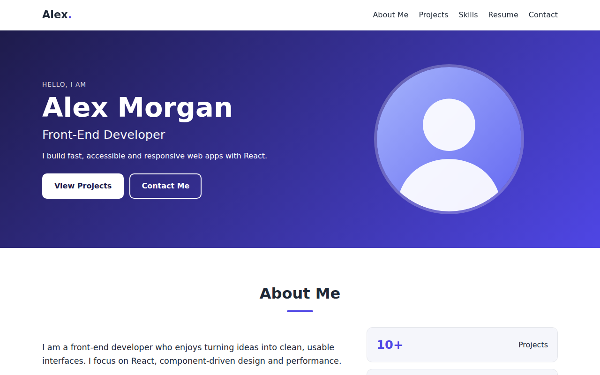
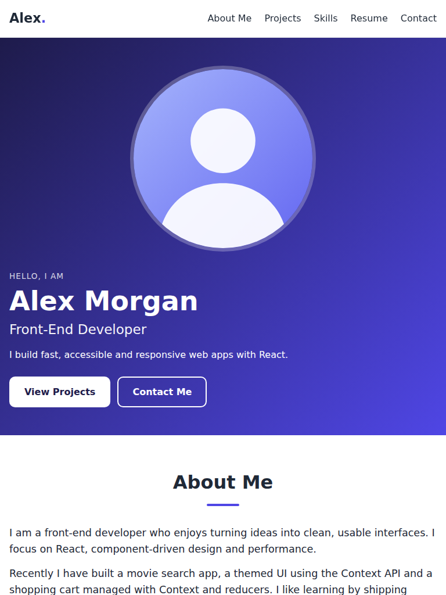
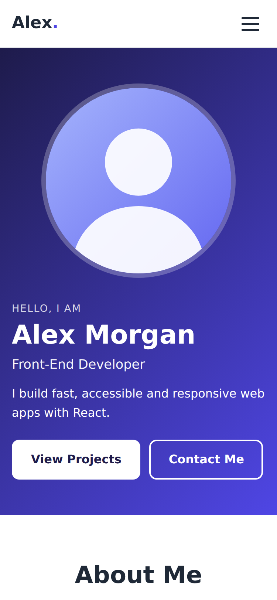
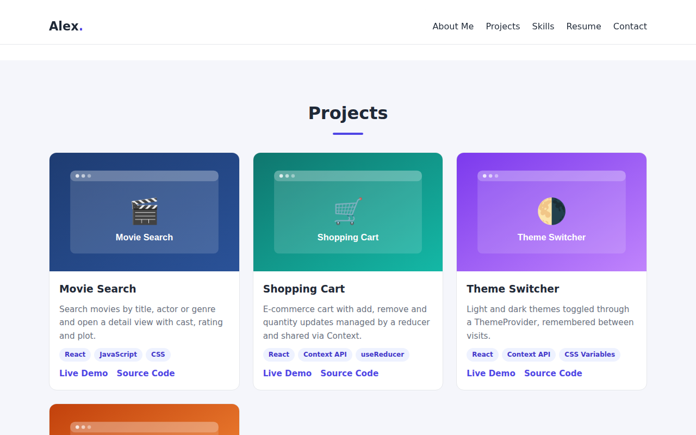
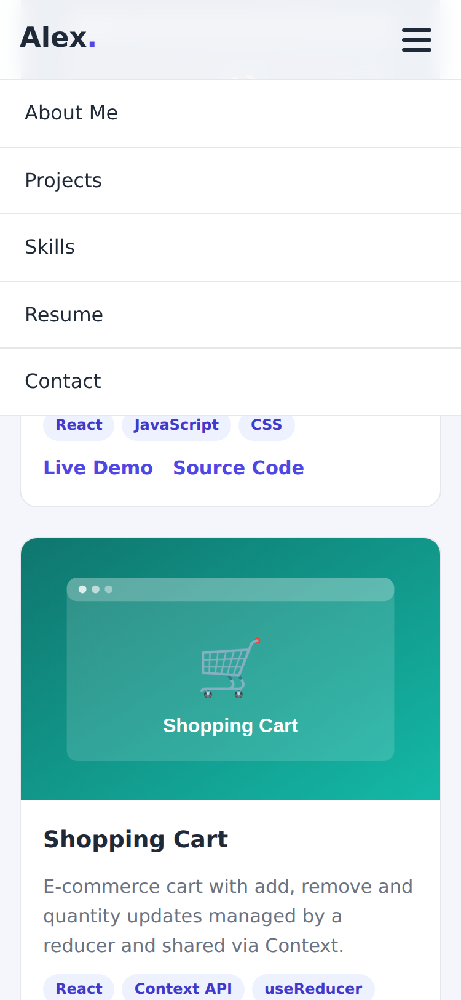
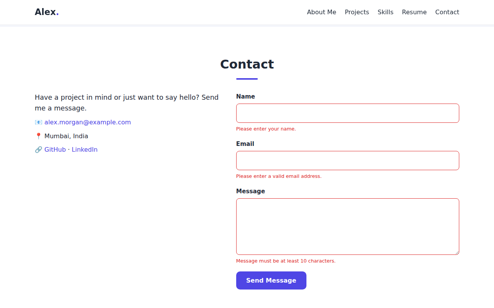

# Shalini Jha | React Portfolio

A responsive, performance-optimised portfolio website built with **React** and **Vite**. It has About Me, Projects, Skills, Resume and Contact sections, lazy-loaded sections and images, and is ready to deploy on **GitHub Pages, Netlify or Vercel**.

> All personal content (name, projects, links, resume) is **sample data**. Replace it with your own in `src/data/portfolio.js` and `public/resume.pdf` before publishing.

| | |
|---|---|
| **Live site** | `https://<https://coruscating-shortbread-90635b.netlify.app/l>` *(add after deployment)* |
| **Repository** | `https://github.com/<shalini0398-star>/<Portfolio.git>` *(add after you push)* |

## Screenshots

| Desktop (1280px) | Tablet (768px) | Mobile (375px) |
|---|---|---|
|  |  |  |

| Projects (desktop) | Mobile menu | Contact form validation |
|---|---|---|
|  |  |  |

Full-page captures: `docs/screenshots/desktop-full-page.png`, `tablet-full-page.png`, `mobile-full-page.png`.

## Features

- **Sections:** Hero, About Me, Projects (cards with tags, demo and code links), Skills (progress bars), Resume (experience, education, PDF download), Contact (validated form).
- **Responsive:** CSS Grid/Flexbox, fluid type with `clamp()`, hamburger menu below 720px, no horizontal scroll from 320px up.
- **Accessible:** semantic HTML, alt text, visible focus outlines, ARIA on the menu button and progress bars, `prefers-reduced-motion` support.
- **Easy to edit:** all content lives in one file, `src/data/portfolio.js`.

## Tech stack

React 19 (hooks, `lazy`, `Suspense`), Vite 5, plain CSS (custom properties), no UI framework.

## Project structure

```
├── index.html
├── vite.config.js          # base "./", minification, vendor chunk
├── netlify.toml            # Netlify build + caching headers
├── vercel.json             # Vercel build + caching headers
├── .github/workflows/deploy.yml   # GitHub Pages deployment
├── public/                 # copied as-is to the build (images, resume.pdf)
└── src/
    ├── main.jsx, App.jsx, index.css
    ├── components/         # Navbar, Hero, Footer, LazyImage, LazySection
    ├── sections/           # About, Projects, Skills, Resume, Contact (lazy-loaded)
    └── data/portfolio.js   # all content
```

## Getting started

Requires Node.js 18+.

```bash
npm install
npm run dev        # development server at http://localhost:5173
npm run build      # production build into dist/
npm run preview    # serve the production build locally
```

## Performance optimisation

| Technique | Where |
|---|---|
| **Lazy-loaded components:** each section is a `React.lazy` chunk; `LazySection` renders it only when it is within 300px of the viewport (IntersectionObserver), so its JavaScript downloads on demand | `src/App.jsx`, `src/components/LazySection.jsx` |
| **Lazy-loaded images:** `loading="lazy"`, `decoding="async"`, fade-in on load. The hero image is above the fold and uses `fetchPriority="high"` | `src/components/LazyImage.jsx`, `Hero.jsx` |
| **No layout shift:** images have `width`/`height` and CSS `aspect-ratio`; lazy sections reserve `min-height` | `LazyImage.jsx`, `LazySection.jsx` |
| **Minified JS and CSS** | `build.minify: "esbuild"`, `cssMinify: true` in `vite.config.js` |
| **Separate React vendor chunk** for long-term caching | `manualChunks` in `vite.config.js` |
| **Fingerprinted assets with immutable caching headers** | `netlify.toml`, `vercel.json` |
| **Lightweight assets:** SVG images, system font stack (no web-font download), no UI library | `public/images`, `index.css` |

### Production build results (measured)

| File | Size | Gzipped |
|---|---|---|
| Main JS (React + app shell) | 183.8 KB | 57.4 KB |
| Main CSS | 5.7 KB | 2.0 KB |
| Section chunks (About, Projects, Skills, Resume, Contact) | 0.7 to 2.5 KB each | 0.3 to 1.0 KB each |
| Shared chunks | 7.7 KB and 3.9 KB | 3.0 KB and 1.9 KB |
| **Total JS + CSS** | | **about 67 KB** |

On a 375px phone only the About chunk loads at startup; the Projects chunk and its four images are fetched when you scroll to them, and Skills, Resume and Contact load just before they come into view. On a tall desktop screen the first two sections are within one screen, so they load immediately.

> These numbers come from a build with esbuild (the bundler Vite uses internally) in an environment without npm registry access. `npm run build` with Vite produces equivalent output, with slightly different file names and sizes.

## Verifying the production build locally

```bash
npm run build
npm run preview     # http://localhost:4173
```

Checks performed against the built site served over HTTP (headless Chromium):

- Page loads with no console or page errors.
- All five sections render; each navbar link scrolls to its section (heading verified after the click).
- Section chunks and project images load on demand (see above).
- Project images carry `loading="lazy"` and fade in.
- Contact form shows three validation errors when submitted empty; valid input shows a confirmation and triggers a pre-filled `mailto:` message. (Whether a mail app opens depends on the visitor's device; this could not be confirmed in a headless browser.)
- `resume.pdf` is served with status 200 and `application/pdf`.
- No horizontal overflow at 1280, 768, 375 and 320px widths.
- Mobile menu opens, and closes after choosing a link.

## Deployment

Pick one provider. The build is configured with `base: "./"`, so it works on a root domain and on a sub-path such as `username.github.io/repo`.

### Option A: Netlify

1. Push the project to GitHub.
2. In Netlify choose **Add new site > Import an existing project**, connect GitHub and select the repository.
3. Netlify reads `netlify.toml`: build command `npm run build`, publish directory `dist`.
4. Click **Deploy**. You get a URL like `https://your-site.netlify.app` with HTTPS enabled.

### Option B: Vercel

1. Push the project to GitHub.
2. In Vercel choose **Add New > Project** and import the repository. The framework is detected as Vite; `vercel.json` sets the output directory.
3. Click **Deploy**. You get `https://your-project.vercel.app` with HTTPS enabled.

### Option C: GitHub Pages

1. Push the project to the `main` branch of a GitHub repository.
2. In the repository open **Settings > Pages** and set **Source** to **GitHub Actions**.
3. The included workflow (`.github/workflows/deploy.yml`) builds and publishes on every push to `main`.
4. The site appears at `https://<username>.github.io/<repo>/`.

### Custom domain and SSL

1. Buy a domain from any registrar.
2. In the provider's dashboard add the domain (Netlify: **Domain management**; Vercel: **Settings > Domains**; GitHub Pages: **Settings > Pages > Custom domain**).
3. At your registrar create the DNS records the provider shows: usually an `A` record (or `ALIAS`/`ANAME`) for the root domain and a `CNAME` record for `www`.
4. Wait for DNS to propagate (minutes to a few hours).
5. SSL: all three providers issue and renew free certificates automatically (Let's Encrypt or equivalent). Enable **Enforce HTTPS** where offered (GitHub Pages: **Enforce HTTPS** checkbox).

## Testing after deployment

Complete this checklist on the live URL and note the results:

- [ ] Site opens over `https://` with a valid certificate (padlock icon)
- [ ] All navigation links and the resume download work
- [ ] No errors in the browser console (F12 > Console)
- [ ] Chrome, Firefox, Safari (and Edge) render the page the same way
- [ ] Layout is correct on a phone, a tablet and a desktop (or use DevTools device mode)
- [ ] Run Lighthouse (DevTools > Lighthouse) and record Performance, Accessibility, Best Practices, SEO

**What has been tested so far:** automated checks in Chromium at 1280, 768, 375 and 320px (see "Verifying the production build"). Firefox, Safari, physical devices and the deployed site still need to be checked by you, because they could not be run in the development environment.

## Challenges and solutions

| Challenge | Solution |
|---|---|
| Navigation links point to sections that are not rendered yet because they are lazy-loaded | Each lazy section sits inside a wrapper that has the `id` and a reserved `min-height`, so the anchor exists immediately and scrolling to it triggers loading |
| Layout jumping while lazy images and sections load | Explicit image `width`/`height`, CSS `aspect-ratio`, and reserved section heights |
| Absolute asset paths break on GitHub Pages sub-paths | `base: "./"` in Vite and relative paths such as `images/avatar.svg` |
| No backend for the contact form | Client-side validation, then a pre-filled `mailto:` message. Netlify Forms or Formspree can replace this to receive messages directly |
| Navigation on small screens | Hamburger menu shown below 720px that closes after selecting a link |
| Large initial JavaScript | Code splitting per section, a separate React vendor chunk, and minification |

## Customising

1. Edit `src/data/portfolio.js` (name, about text, projects, skills, resume entries, links).
2. Replace images in `public/images/` (keep the file names or update the paths in the data file).
3. Replace `public/resume.pdf` and the email address.
4. Update the `<title>` and description in `index.html`.

## Future improvements

Dark mode toggle, project filtering by technology, a blog section, and Lighthouse CI in the deployment workflow.

## License

MIT. Free to use and adapt.
